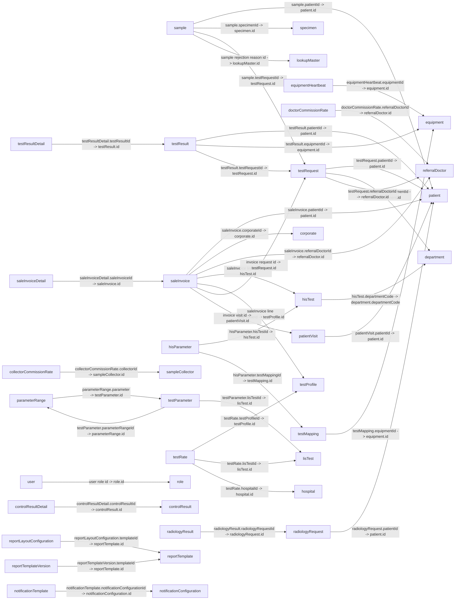

# ZoryaLMS Left-Menu Entity Relationship Diagram

This ERD covers the persisted modules exposed through the current left menu and the supporting collections they reference. It also records menu pages that are previews or report views rather than persisted data entities.

## Scope

| Left-menu section | Persisted modules |
|---|---|
| Working Board | `sample`, `testResult`, `radiologyResult`, `controlResult` |
| Setup | `department`, `unit`, `method`, `equipment`, `equipmentHeartbeat`, `reportTemplateConfiguration` |
| Master | `hisTest`, `testProfile`, `specimen`, `testRate`, `referralDoctor`, `doctorCommissionRate`, `sampleCollector`, `collectorCommissionRate`, `corporate`, `hisParameter`, `testMapping`, `testParameter`, `parameterRange` |
| Transaction | `patient`, `saleInvoice` |
| Account | `user`, `role` |

The Working Board workflows also read/write these modules; the workflows are not separate collections. Additional referenced collections and non-persisted menu views are documented below.

## Relationship diagram

Arrows point from the document containing a lookup field to its target. Labels use `source.field -> target.field`. They are not database-enforced foreign keys or cardinality guarantees. Supporting collections are included where they complete a menu module's relationship.

## Field mapping rules

- The LIS `relation()` helper stores the configured `valueField`; it defaults to the Firestore document ID (`id`). The menu module `hisTest.departmentCode` stores `department.departmentCode`.
- The custom Sale Invoice page selects Patient, Corporate, Referral Doctor, HIS Test, and Test Profile documents by ID. It embeds selected test/profile data in invoice line maps; department values and copied labels are snapshots, not guaranteed references.
- User Roles are embedded maps in `user.roles[]` containing the selected `role.id`, role name, and a copy of role privileges.
- Values described as lookups are strings in Firestore, not Firestore `DocumentReference` values. Firestore does not enforce referential integrity.
- `*` means the form marks the field as required; it does not mean Firestore validates it.
- Common fields added by the shared Firestore service are `status: string`, `schema: string`, `user: string`, `dateCreated: string`, `application: string`, and `access: string`. Firestore document IDs are exposed by the application as `id: string`.
- Date and datetime fields follow form controls; the application does not consistently enforce Firestore Timestamp types.

## Menu module fields

Types are based on current React form definitions. `enum<string>` lists the menu choices; `array<map>` denotes embedded data.

### Working Board

| Collection | Fields |
|---|---|
| `sample` | `sampleNo: string*`; `testRequestId: string` (lookup to `testRequest.id`); `patientId: string*` (lookup to `patient.id`); `specimenId: string` (lookup to `specimen.id`); `barcode: string`; `sampleCollectionDate: datetime`; `collectedBy: string`; `collectionStatus: enum<string> [Pending, Collected, Rejected]`; `sampleReceivedDate: datetime`; `receivedBy: string`; `receivingStatus: enum<string> [Pending, Received, Rejected]`; `rejectionReasonId: string` (lookup to `lookupMaster.id`); `status: enum<string> [Pending, Collected, Received, Rejected, Processing, Completed]` |
| `testResult` | `patientId: string*` (lookup to `patient.id`); `testRequestId: string*` (lookup to `testRequest.id`); `sampleNo: string`; `hisTestCode: string`; `lisTestCode: string`; `specimenCode: string`; `specimenName: string`; `resultDate: datetime`; `sampleCollectionDate: datetime`; `sampleReceivedDate: datetime`; `authorizationDate: datetime`; `authorizedBy: string`; `reviewDate: datetime`; `reviewedBy: string`; `technicianNote: string`; `doctorNote: string`; `equipmentId: string` (lookup to `equipment.id`) |
| `radiologyResult` | `radiologyRequestId: string*` (lookup to `radiologyRequest.id`); `findings: string`; `impression: string`; `reportDateTime: datetime`; `reportedBy: string`; `status: enum<string> [Draft, Finalized, Cancelled]` |
| `controlResult` | `controlNo: string*`; `testName: string*`; `controlLevel: enum<string> [Level 1, Level 2, Level 3]`; `resultDate: date`; `status: enum<string> [In Control, Out of Control]` |

### Setup

| Collection | Fields |
|---|---|
| `department` | `departmentCode: string*`; `departmentName: string*`; `isActive: enum<string> [Yes, No]` |
| `unit` | `code: string*`; `name: string*`; `isActive: enum<string> [Yes, No]` |
| `method` | `code: string*`; `name: string*`; `isActive: enum<string> [Yes, No]` |
| `equipment` | `name: string*`; `model: string`; `accessKey: string*`; `isActive: enum<string> [Yes, No]` |
| `equipmentHeartbeat` | `equipmentId: string*` (lookup to `equipment.id`); `lastHeartBeatTime: datetime*`; `isOnline: enum<string> [Yes, No]`; `lastErrorMessage: string`; `recordedOn: date` |
| `reportTemplateConfiguration` | `templateName: string*`; `templateType: string`; `templateContent: string`; `isActive: enum<string> [Yes, No]` |

### Master

| Collection | Fields |
|---|---|
| `hisTest` | `hisTestCode: string*`; `hisTestCodeDescription: string*`; `hisSpecimenCode: string`; `hisSpecimenName: string`; `departmentCode: string` (lookup value is `department.departmentCode`); `isActive: enum<string> [Yes, No]` |
| `testProfile` | `code: string*`; `name: string*`; `packageRate: number`; `isActive: enum<string> [Yes, No]` |
| `specimen` | `specimenCode: string*`; `specimenName: string*`; `isActive: enum<string> [Yes, No]` |
| `testRate` | `rateName: string*`; `lisTestId: string` (lookup to `lisTest.id`); `testProfileId: string` (lookup to `testProfile.id`); `rate: number*`; `effectiveFrom: date`; `effectiveTo: date`; `hospitalId: string` (lookup to `hospital.id`); `isActive: enum<string> [Yes, No]` |
| `referralDoctor` | `doctorCode: string*`; `doctorName: string*`; `qualification: string`; `phoneNumber: string`; `email: string`; `isActive: enum<string> [Yes, No]` |
| `doctorCommissionRate` | `referralDoctorId: string*` (lookup to `referralDoctor.id`); `commissionPercent: number*`; `effectiveFrom: date*`; `effectiveTo: date`; `isActive: enum<string> [Yes, No]` |
| `sampleCollector` | `code: string*`; `name: string*`; `phone: string`; `isActive: enum<string> [Yes, No]` |
| `collectorCommissionRate` | `collectorId: string*` (lookup to `sampleCollector.id`); `commissionPercent: number*`; `effectiveFrom: date*`; `effectiveTo: date`; `isActive: enum<string> [Yes, No]` |
| `corporate` | `code: string*`; `name: string*`; `defaultDiscountPercent: number`; `isActive: enum<string> [Yes, No]` |
| `hisParameter` | `hisParamCode: string*`; `hisParamDescription: string*`; `hisTestId: string*` (lookup to `hisTest.id`); `testMappingId: string` (lookup to `testMapping.id`); `lisParamCode: string`; `unit: string`; `lowerRefRange: number`; `upperRefRange: number`; `isActive: enum<string> [Yes, No]` |
| `testMapping` | `equipmentId: string*` (lookup to `equipment.id`); `hisParamCode: string`; `hisParamDescription: string`; `specimenCode: string`; `specimenName: string`; `lisTestCode: string*`; `lisTestCodeDescription: string*`; `groupName: string`; `isActive: enum<string> [Yes, No]` |
| `testParameter` | `parameterCode: string*`; `parameterName: string*`; `lisTestId: string*` (lookup to `lisTest.id`); `unit: string`; `parameterRangeId: string` (lookup to `parameterRange.id`); `isActive: enum<string> [Yes, No]` |
| `parameterRange` | `rangeCode: string` (read-only); `rangeValue: string`; `gender: enum<string> [Male, Female, Both]*`; `ageFrom: number`; `ageTo: number`; `ageType: enum<string> [Year, Month, Day]`; `minValue: number`; `maxValue: number`; `parameter: string*` (lookup to `testParameter.id`) |

### Transaction

| Collection | Fields |
|---|---|
| `patient` | `mrNo: string` (read-only); `visitId: string` (read-only); `name: string*`; `hisPatientId: string`; `phoneNumber: string*`; `dateOfBirth: date`; `patientNo: string` (read-only); `salutation: enum<string> [Mr, Mr., Miss, Mrs., Ms.]*`; `gender: enum<string> [M, F]*`; `age: number`; `address: string`; `active: enum<string> [Yes, No]` (edit/view schema) |
| `saleInvoice` | Generic module fields: `invoiceNo: string*`; `invoiceDate: date*`; `invoiceStatus: enum<string> [Draft, Finalized, Cancelled]`; `paymentStatus: enum<string> [Pending, Paid]`; `patientId: string*` (lookup to `patient.id`); `requestDetailId: string` (lookup to `testRequest.id`); `patientVisitId: string` (lookup to `patientVisit.id`); `totalAmount: number`. Custom Add page additionally writes `name: string`; `patientName: string`; `patientNo: string`; `patientPhone: string`; `corporateId: string|null` (document ID); `referralDoctorId: string|null` (document ID); `paymentType: enum<string> [Cash, Card, UPI, Net Banking, Cheque, Credit]`; `notes: string`; `invoiceStatus: number [0 Draft, 1 Confirmed]`; `paymentStatus: number [0 Unpaid, 1 Partially Paid, 2 Paid]`; `grossAmount: number`; `discountType: enum<string> [Fixed Amount, Percentage]`; `discountValue: number`; `discountAmount: number`; `taxAmount: number`; `netAmount: number`; `paidAmount: number`; `dueAmount: number`; `lines: array<map>`. The custom Add page does not write `totalAmount`, `requestDetailId`, or `patientVisitId`. |
| `saleInvoice.lines[]` (embedded map) | `itemType: enum<string> [test, profile]`; `lineItemKey: string`; `testId: string` (HIS Test document ID for test lines, empty for profile lines); `testProfileId: string|null` (Test Profile document ID for profile lines); `testName: string`; `departmentCode: string`; `departmentName: string`; `rate: number`; `quantity: number`; `discountType: enum<string> [Fixed Amount, Percentage]`; `discountValue: number`; `amount: number`; `discountAmount: number`; `netAmount: number`. No line-level `taxAmount` or `sampleNo` is written. |

### Account

| Collection | Fields |
|---|---|
| `user` | `email: string*`; `firstName: string*`; `lastName: string*`; `phoneNumber: string`; `department: enum<string> [Civil, Legal]*`; `disable: boolean`; `address: string`; `photoUrl: string`; `roles: array<map>` containing `id: string` (role document ID), `name: string`, and copied `privileges: array<map>`; `privileges: array<map>` (derived/read-only in user form); Auth-created records may also include `uid: string` and `displayName: string` |
| `role` | `name: string*`; `privileges: array<map>` |

## Supporting and referenced collections

These definitions are present in `lisModuleDefinitions.js` and/or are read by the menu workflows. They are included to complete the displayed relationships, even though they do not appear as standalone menu items.

| Collection | Fields |
|---|---|
| `testRequest` | `patientId: string*` (lookup to `patient.id`); `sampleNo: string*`; `hisTestCode: string`; `hisTestName: string`; `specimenCode: string`; `specimenName: string`; `sampleCollectionDate: datetime`; `sampleReceivedDate: datetime`; `departmentId: string` (lookup to `department.id`); `referralDoctorId: string` (lookup to `referralDoctor.id`); `department: string`; `hisRequestId: string`; `hisRequestNo: string`; `reportStatus: enum<string> [Pending, In Progress, Completed, Cancelled]`; `collectedBy: string`; `receivedBy: string` |
| `testResultDetail` | `testResultId: string*` (lookup to `testResult.id`); `parameterCode: string`; `parameterName: string*`; `result: string*`; `unit: string`; `referenceRange: string`; `status: enum<string> [Normal, Abnormal, Critical]` |
| `controlResultDetail` | `controlResultId: string*` (lookup to `controlResult.id`); `parameterName: string*`; `result: number`; `mean: number`; `sd: number`; `cv: number`; `status: enum<string> [In Control, Out of Control]` |
| `lookupMaster` | `lookupType: enum<string> [Sample Type, Test Category, Test Group, Method, Unit, Container, Sample Rejection Reason, Corporate, Facility]*`; `code: string`; `name: string*`; `description: string`; `isActive: enum<string> [Yes, No]` |
| `radiologyRequest` | `patientId: string*` (lookup to `patient.id`); `requestNo: string*`; `examType: string*`; `requestDateTime: datetime`; `examDateTime: datetime`; `comments: string`; `status: enum<string> [Pending, Scheduled, Completed, Cancelled]` |
| `lisTest` | `testCode: string*`; `name: string*`; `description: string`; `specimenId: string` (lookup to `specimen.id`); `departmentCode: string` (lookup value is `department.departmentCode`); `isActive: enum<string> [Yes, No]` |
| `hospital` | `hospitalCode: string*`; `hospitalName: string*`; `corporateName: string`; `phoneNumber: string`; `email: string`; `address: string`; `isActive: enum<string> [Yes, No]` |
| `patientVisit` | `patientId: string*` (lookup to `patient.id`); `visitId: string*`; `visitDateTime: datetime*`; `saleInvoiceId: string` (lookup to `saleInvoice.id`); `visitStatus: enum<string> [Scheduled, In Progress, Completed, Cancelled]`; `isActive: enum<string> [Yes, No]`; `createdBy: string`; `modifiedBy: string` |
| `saleInvoiceDetail` | `saleInvoiceId: string*` (lookup to `saleInvoice.id`); `testCode: string`; `testName: string*`; `quantity: number*`; `rate: number*`; `amount: number`. This is a separate collection from custom invoice `lines[]` and is not written by the custom Sale Invoice Add page. |
| `reportTemplate` | `templateName: string*`; `templateCode: string*`; `description: string`; `templateJson: string`; `isActive: enum<string> [Yes, No]` |
| `reportTemplateVersion` | `templateId: string*` (lookup to `reportTemplate.id`); `versionNumber: number*`; `versionJson: string`; `isActive: enum<string> [Yes, No]` |
| `reportLayoutConfiguration` (declared module schema) | `templateId: string*` (lookup to `reportTemplate.id`); `headerImage: string`; `footerText: string`; `fontFamily: string`; `pageOrientation: enum<string> [Portrait, Landscape]`; `margins: string`. The menu's React page is only a preview; its Save button is disabled, so these values are not currently persisted through that page. |
| `notificationConfiguration` (declared module schema) | `notificationName: string*`; `eventType: string*`; `channel: enum<string> [Email, SMS, HTTP]`; `recipients: string`; `isActive: enum<string> [Yes, No]`. The menu's React page instead shows local preview state and a disabled Save button; it does not persist this schema. |
| `notificationTemplate` | `notificationConfigurationId: string*` (lookup to `notificationConfiguration.id`); `templateName: string*`; `subject: string`; `body: string`; `placeholder: string`. No active menu page writes this collection. |

## Menu views without persisted entities

The following items are included as UI/report concepts, not Firestore entities:

| Menu item / page | Data represented in the UI | Persistence in current React app |
|---|---|---|
| Notification Configuration preview | Local state: `isEnabled: boolean`, `smsEnabled: boolean`, `whatsAppEnabled: boolean`, `channelMode: enum<string> [separate, combined]`, `retryCount: number` (held as input string), `retryInterval: number` (held as input string), `defaultChannel: enum<string> [SMS, WhatsApp, Email]` | No persistence; saving/sending requires the external notification service. The declared `notificationConfiguration` schema is listed above separately. |
| Report Layout Configuration preview | Local state: `fontFamily: string`, `orientation: enum<string> [Portrait, Landscape]`, `margins: string`, `footer: string`; template select and header upload are presentational | No persistence; Save is disabled. The declared `reportLayoutConfiguration` schema is listed above separately. |
| Reports | Menu routes render report views over operational data. The route configurations define report filters and display columns; they do not define collections or persisted report records. | No report service connected; searching/exporting is UI-only. |
| Commission Payout and Payout Memo | UI controls show recipient type (Referral Doctor/Sample Collector), recipient, period, payout number, invoice, commission base, rate, amount, and total. | No payout collection/schema or service is connected; preview, confirm, history, and print are disabled/unavailable. |
| Change Password | Firebase Authentication credential operation | Firebase Authentication, not a Firestore collection. |

## Data-integrity notes

- The custom Sale Invoice page embeds line items in `saleInvoice.lines[]`; `saleInvoiceDetail` remains a separate module schema and is not used by that page.
- The generic Sale Invoice form uses string status choices, while the custom Add page writes numeric invoice/payment statuses. Existing documents can therefore contain different types for these fields.
- Workflow screens read `testRequest`, `testResultDetail`, and `controlResultDetail`; these supporting modules complete the ER relationships but are not necessarily navigable as normal menu pages.
- Report and notification configuration schemas exist in the module registry, but custom preview routes do not currently save to Firestore.

## Maintenance

Keep this ERD aligned with `lisModuleMenu` and related definitions in `src/pages/app/schema/lisModuleDefinitions.js`, custom routes in `src/pages/app/LISWorkflowPages.jsx` and `src/pages/app/LISSetupPages.jsx`, and the Patient/User/Role forms. When a menu item or field mapping changes, update the relevant table and relationship diagram from those definitions.
