# ZoryaLMS Entity Relationship Diagram

This document describes the entities and fields declared by the React application's LIS module definitions and schema-driven forms.

## Scope and interpretation

- Firestore is schemaless. Field types below are the types implied by the application's form definitions, not Firestore-enforced types. Existing documents may differ or contain additional fields.
- The field names are the application field names. Field names are case-sensitive.
- `string`, `number`, `boolean`, `date`, `datetime`, `array`, `map`, and `reference/string-id` describe intended values. Dates are commonly written as strings or JavaScript Date values by current code; the application does not enforce Firestore Timestamp consistently.
- `reference/string-id -> collection.field` means a stored lookup value intended to identify a document/record. It is not a Firestore `DocumentReference` unless explicitly migrated; current forms generally store an ID value.
- `required` reflects the form's validation configuration only.
- All records created through the shared Firestore service also receive `status: string`, `schema: string`, `user: string`, `dateCreated: string`, `application: string`, and `access: string`. These are common service metadata, not uniformly declared in each form. Firestore document IDs are exposed by the client as `id: string`.
- Custom Sale Invoice creation stores line items in the invoice's `lines` array. The separately defined `saleInvoiceDetail` collection/schema is retained for compatibility and is not automatically used by that custom add form.

## Relationship overview

```mermaid
erDiagram
    PATIENT ||--o{ PATIENT_VISIT : has
    PATIENT ||--o{ TEST_REQUEST : requests
    PATIENT ||--o{ SAMPLE : provides
    PATIENT ||--o{ SALE_INVOICE : billed
    PATIENT ||--o{ RADIOLOGY_REQUEST : referred_for
    PATIENT_VISIT o|--o{ SALE_INVOICE : associated_with
    SALE_INVOICE o|--o{ PATIENT_VISIT : visit_invoice
    TEST_REQUEST o|--o{ SAMPLE : collected_as
    TEST_REQUEST ||--o{ TEST_RESULT : produces
    PATIENT ||--o{ TEST_RESULT : has
    TEST_RESULT ||--o{ TEST_RESULT_DETAIL : contains
    SPECIMEN o|--o{ SAMPLE : identifies
    LOOKUP_MASTER o|--o{ SAMPLE : rejection_reason
    DEPARTMENT o|--o{ TEST_REQUEST : assigned_to
    REFERRAL_DOCTOR o|--o{ TEST_REQUEST : referred_by
    REFERRAL_DOCTOR ||--o{ DOCTOR_COMMISSION_RATE : rate_history
    SAMPLE_COLLECTOR ||--o{ COLLECTOR_COMMISSION_RATE : rate_history
    LIS_TEST o|--o{ TEST_PARAMETER : defines
    PARAMETER_RANGE o|--o{ TEST_PARAMETER : reference_range
    LIS_TEST ||--o{ TEST_PROFILE_DETAIL : included_in
    TEST_PROFILE ||--o{ TEST_PROFILE_DETAIL : includes
    LIS_TEST o|--o{ TEST_RATE : priced_by
    TEST_PROFILE o|--o{ TEST_RATE : priced_by
    HOSPITAL o|--o{ TEST_RATE : facility_rate
    EQUIPMENT ||--o{ EQUIPMENT_HEARTBEAT : reports
    EQUIPMENT ||--o{ TEST_MAPPING : maps
    HIS_TEST ||--o{ HIS_PARAMETER : defines
    TEST_MAPPING o|--o{ HIS_PARAMETER : maps_parameter
    RADIOLOGY_REQUEST ||--o{ RADIOLOGY_RESULT : reports
    CONTROL_RESULT ||--o{ CONTROL_RESULT_DETAIL : contains
    REPORT_TEMPLATE ||--o{ REPORT_TEMPLATE_VERSION : versions
    REPORT_TEMPLATE ||--o{ REPORT_LAYOUT_CONFIGURATION : layout
    NOTIFICATION_CONFIGURATION ||--o{ NOTIFICATION_TEMPLATE : templates
    SALE_INVOICE ||--o{ SALE_INVOICE_DETAIL : details
    COMPANY ||--o{ PROJECT : owns
    PROJECT ||--o{ TOWER : contains
    PROJECT ||--o{ FLOOR : contains
    TOWER ||--o{ FLOOR : contains
    PROJECT ||--o{ FLAT : contains
    TOWER ||--o{ FLAT : contains
    FLOOR ||--o{ FLAT : contains
    ITEM_GROUP o|--o{ ITEM_MASTER : groups
    PRODUCT_TYPE ||--o{ PRODUCT : classifies
    PURITY ||--o{ DAILY_PRICE : priced_by
    SUPPLIER ||--o{ SUPPLIER_PURCHASE : supplies
    INVOICE ||--o{ INVOICE_ITEM : contains
    COMPANY o|--o{ COMPANY : parent_company
```

The diagram shows relationships declared by form lookups and module definitions. Optional lookups are marked with `o|`; the exact cardinality and referential integrity are not enforced by Firestore.

## LIS and laboratory entities

| Entity / collection | Fields (`field: type`; `*` = form-required) |
|---|---|
| `unit` | `code: string*`; `name: string*`; `isActive: enum<string> [Yes, No]` |
| `method` | `code: string*`; `name: string*`; `isActive: enum<string> [Yes, No]` |
| `sampleCollector` | `code: string*`; `name: string*`; `phone: string`; `isActive: enum<string> [Yes, No]` |
| `doctorCommissionRate` | `referralDoctorId: reference/string-id -> referralDoctor.id*`; `commissionPercent: number*`; `effectiveFrom: date*`; `effectiveTo: date`; `isActive: enum<string> [Yes, No]` |
| `collectorCommissionRate` | `collectorId: reference/string-id -> sampleCollector.id*`; `commissionPercent: number*`; `effectiveFrom: date*`; `effectiveTo: date`; `isActive: enum<string> [Yes, No]` |
| `corporate` | `code: string*`; `name: string*`; `defaultDiscountPercent: number`; `isActive: enum<string> [Yes, No]` |
| `testGroup` | `code: string*`; `name: string*`; `specimenTag: string`; `isActive: enum<string> [Yes, No]` |
| `testCategory` | `code: string*`; `name: string*`; `isActive: enum<string> [Yes, No]` |
| `sampleType` | `code: string*`; `name: string*`; `isActive: enum<string> [Yes, No]` |
| `container` | `code: string*`; `name: string*`; `color: string`; `isActive: enum<string> [Yes, No]` |
| `reportTemplateConfiguration` | `templateName: string*`; `templateType: string`; `templateContent: string (long text)`; `isActive: enum<string> [Yes, No]` |
| `clientApplication` | `name: string*`; `code: string`; `description: string (long text)`; `baseUrl: string`; `isActive: enum<string> [Yes, No]` |
| `sample` | `sampleNo: string*`; `testRequestId: reference/string-id -> testRequest.id`; `patientId: reference/string-id -> patient.id*`; `specimenId: reference/string-id -> specimen.id`; `barcode: string`; `sampleCollectionDate: datetime`; `collectedBy: string`; `collectionStatus: enum<string> [Pending, Collected, Rejected]`; `sampleReceivedDate: datetime`; `receivedBy: string`; `receivingStatus: enum<string> [Pending, Received, Rejected]`; `rejectionReasonId: reference/string-id -> lookupMaster.id`; `status: enum<string> [Pending, Collected, Received, Rejected, Processing, Completed]` |
| `specimen` | `specimenCode: string*`; `specimenName: string*`; `isActive: enum<string> [Yes, No]` |
| `lisTest` | `testCode: string*`; `name: string*`; `description: string (long text)`; `specimenId: reference/string-id -> specimen.id`; `departmentCode: reference/string-id -> department.departmentCode`; `isActive: enum<string> [Yes, No]` |
| `testParameter` | `parameterCode: string*`; `parameterName: string*`; `lisTestId: reference/string-id -> lisTest.id*`; `unit: string`; `parameterRangeId: reference/string-id -> parameterRange.id`; `isActive: enum<string> [Yes, No]` |
| `testRate` | `rateName: string*`; `lisTestId: reference/string-id -> lisTest.id`; `testProfileId: reference/string-id -> testProfile.id`; `rate: number*`; `effectiveFrom: date`; `effectiveTo: date`; `hospitalId: reference/string-id -> hospital.id`; `isActive: enum<string> [Yes, No]` |
| `hospital` | `hospitalCode: string*`; `hospitalName: string*`; `corporateName: string`; `phoneNumber: string`; `email: string`; `address: string (long text)`; `isActive: enum<string> [Yes, No]` |
| `lookupMaster` | `lookupType: enum<string> [Sample Type, Test Category, Test Group, Method, Unit, Container, Sample Rejection Reason, Corporate, Facility]*`; `code: string`; `name: string*`; `description: string (long text)`; `isActive: enum<string> [Yes, No]` |
| `externalApi` | `name: string*`; `system: string*`; `baseUrl: string*`; `authenticationType: enum<string> [OAuth 2.0, API Key, Basic, None]`; `credentialReference: string`; `direction: enum<string> [Import, Export, Bidirectional]`; `isActive: enum<string> [Yes, No]` |
| `patientVisit` | `patientId: reference/string-id -> patient.id*`; `visitId: string*`; `visitDateTime: datetime*`; `saleInvoiceId: reference/string-id -> saleInvoice.id`; `visitStatus: enum<string> [Scheduled, In Progress, Completed, Cancelled]`; `isActive: enum<string> [Yes, No]`; `createdBy: string`; `modifiedBy: string` |
| `testRequest` | `patientId: reference/string-id -> patient.id*`; `sampleNo: string*`; `hisTestCode: string`; `hisTestName: string`; `specimenCode: string`; `specimenName: string`; `sampleCollectionDate: datetime`; `sampleReceivedDate: datetime`; `departmentId: reference/string-id -> department.id`; `referralDoctorId: reference/string-id -> referralDoctor.id`; `department: string`; `hisRequestId: string`; `hisRequestNo: string`; `reportStatus: enum<string> [Pending, In Progress, Completed, Cancelled]`; `collectedBy: string`; `receivedBy: string` |
| `testResult` | `patientId: reference/string-id -> patient.id*`; `testRequestId: reference/string-id -> testRequest.id*`; `sampleNo: string`; `hisTestCode: string`; `lisTestCode: string`; `specimenCode: string`; `specimenName: string`; `resultDate: datetime`; `sampleCollectionDate: datetime`; `sampleReceivedDate: datetime`; `authorizationDate: datetime`; `authorizedBy: string`; `reviewDate: datetime`; `reviewedBy: string`; `technicianNote: string (long text)`; `doctorNote: string (long text)`; `equipmentId: reference/string-id -> equipment.id` |
| `testResultDetail` | `testResultId: reference/string-id -> testResult.id*`; `parameterCode: string`; `parameterName: string*`; `result: string*`; `unit: string`; `referenceRange: string`; `status: enum<string> [Normal, Abnormal, Critical]` |
| `saleInvoice` | `invoiceNo: string*`; `invoiceDate: date*`; `invoiceStatus: enum<string> [Draft, Finalized, Cancelled]`; `paymentStatus: enum<string> [Pending, Paid]`; `patientId: reference/string-id -> patient.id*`; `requestDetailId: reference/string-id -> testRequest.id`; `patientVisitId: reference/string-id -> patientVisit.id`; `totalAmount: number`; custom add form: `corporateId: reference/string-id -> corporate.id`; `referralDoctorId: reference/string-id -> referralDoctor.id`; `paymentType: string`; `notes: string`; `grossAmount: number`; `discountType: enum<string> [Percentage, Fixed Amount]`; `discountValue: number`; `discountAmount: number`; `taxAmount: number`; `netAmount: number`; `paidAmount: number`; `dueAmount: number`; `lines: array<map>` with `itemType: enum<string> [test, profile]`, `lineItemKey: string`, `testId: string`, `testProfileId: string|null`, `testName: string`, `departmentCode: string`, `departmentName: string`, `rate: number`, `quantity: number`, `discountType: enum<string> [Fixed Amount, Percentage]`, `discountValue: number`, `amount: number`, `discountAmount: number`, `taxAmount: number`, `netAmount: number`, `sampleNo: string` |
| `saleInvoiceDetail` | `saleInvoiceId: reference/string-id -> saleInvoice.id*`; `testCode: string`; `testName: string*`; `quantity: number*`; `rate: number*`; `amount: number` |
| `hisTest` | `hisTestCode: string*`; `hisTestCodeDescription: string*`; `hisSpecimenCode: string`; `hisSpecimenName: string`; `departmentCode: reference/string-id -> department.departmentCode`; `isActive: enum<string> [Yes, No]` |
| `hisParameter` | `hisParamCode: string*`; `hisParamDescription: string*`; `hisTestId: reference/string-id -> hisTest.id*`; `testMappingId: reference/string-id -> testMapping.id`; `lisParamCode: string`; `unit: string`; `lowerRefRange: number`; `upperRefRange: number`; `isActive: enum<string> [Yes, No]` |
| `testMapping` | `equipmentId: reference/string-id -> equipment.id*`; `hisParamCode: string`; `hisParamDescription: string`; `specimenCode: string`; `specimenName: string`; `lisTestCode: string*`; `lisTestCodeDescription: string*`; `groupName: string`; `isActive: enum<string> [Yes, No]` |
| `equipment` | `name: string*`; `model: string`; `accessKey: string*`; `isActive: enum<string> [Yes, No]` |
| `equipmentHeartbeat` | `equipmentId: reference/string-id -> equipment.id*`; `lastHeartBeatTime: datetime*`; `isOnline: enum<string> [Yes, No]`; `lastErrorMessage: string (long text)`; `recordedOn: date` |
| `testProfile` | `code: string*`; `name: string*`; `packageRate: number`; `isActive: enum<string> [Yes, No]` |
| `testProfileDetail` | `profileId: reference/string-id -> testProfile.id*`; `testCode: reference/string-id -> hisTest.hisTestCode*`; `testName: string`; `sequence: number` |
| `department` | `departmentCode: string*`; `departmentName: string*`; `isActive: enum<string> [Yes, No]` |
| `referralDoctor` | `doctorCode: string*`; `doctorName: string*`; `qualification: string`; `phoneNumber: string`; `email: string`; `isActive: enum<string> [Yes, No]` |
| `radiologyRequest` | `patientId: reference/string-id -> patient.id*`; `requestNo: string*`; `examType: string*`; `requestDateTime: datetime`; `examDateTime: datetime`; `comments: string (long text)`; `status: enum<string> [Pending, Scheduled, Completed, Cancelled]` |
| `radiologyResult` | `radiologyRequestId: reference/string-id -> radiologyRequest.id*`; `findings: string (long text)`; `impression: string (long text)`; `reportDateTime: datetime`; `reportedBy: string`; `status: enum<string> [Draft, Finalized, Cancelled]` |
| `controlResult` | `controlNo: string*`; `testName: string*`; `controlLevel: enum<string> [Level 1, Level 2, Level 3]`; `resultDate: date`; `status: enum<string> [In Control, Out of Control]` |
| `controlResultDetail` | `controlResultId: reference/string-id -> controlResult.id*`; `parameterName: string*`; `result: number`; `mean: number`; `sd: number`; `cv: number`; `status: enum<string> [In Control, Out of Control]` |
| `reportTemplate` | `templateName: string*`; `templateCode: string*`; `description: string (long text)`; `templateJson: string (long text)`; `isActive: enum<string> [Yes, No]` |
| `reportTemplateVersion` | `templateId: reference/string-id -> reportTemplate.id*`; `versionNumber: number*`; `versionJson: string (long text)`; `isActive: enum<string> [Yes, No]` |
| `reportLayoutConfiguration` | `templateId: reference/string-id -> reportTemplate.id*`; `headerImage: string`; `footerText: string (long text)`; `fontFamily: string`; `pageOrientation: enum<string> [Portrait, Landscape]`; `margins: string` |
| `notificationConfiguration` | `notificationName: string*`; `eventType: string*`; `channel: enum<string> [Email, SMS, HTTP]`; `recipients: string (long text)`; `isActive: enum<string> [Yes, No]` |
| `notificationTemplate` | `notificationConfigurationId: reference/string-id -> notificationConfiguration.id*`; `templateName: string*`; `subject: string`; `body: string (long text)`; `placeholder: string (long text)` |

## Patient, employee, and identity entities

| Entity / collection | Fields (`field: type`; `*` = form-required) |
|---|---|
| `patient` | `mrNo: string`; `visitId: string`; `name: string*`; `hisPatientId: string`; `phoneNumber: string*`; `dateOfBirth: date`; `patientNo: string`; `salutation: enum<string> [Mr, Mr., Miss, Mrs., Ms.]*`; `gender: enum<string> [M, F]*`; `age: number`; `address: string (long text)`; `active: enum<string> [Yes, No]` |
| `parameterRange` | `rangeCode: string (generated/read-only)`; `rangeValue: string`; `gender: enum<string> [Male, Female, Both]*`; `ageFrom: number`; `ageTo: number`; `ageType: enum<string> [Year, Month, Day]`; `minValue: number`; `maxValue: number`; `parameter: reference/string-id -> testParameter.id*` |
| `employee` | `name: string*`; `age: number*`; `gender: string*`; `salary: number*`; `designation: string*` |
| `user` | `email: string`; `firstName: string`; `lastName: string`; `phoneNumber: string`; `department: string`; `disable: boolean`; `address: string (long text)`; `photoUrl: string`; `roles: array<map>`; `privileges: array<map> (derived)`; authentication identity fields may include `uid: string` and `displayName: string` |
| `role` | `name: string`; `privileges: array<map>` |

`user.roles`, `user.privileges`, and `role.privileges` are embedded maps/arrays, not separate relational collections. Authentication passwords are managed by Firebase Authentication and must not be stored in Firestore documents.

## Existing business and inventory entities

| Entity / collection | Fields (`field: type`; `*` = form-required) |
|---|---|
| `company` | `name: string`; `code: string`; `type: enum/string`; `belongTo: reference/string-id -> company.id`; `zone: string`; `address1: string`; `address2: string`; `address3: string`; `country: string`; `state: string`; `city: string`; `pinCode: number`; `latitude: number`; `longitude: number`; `pH: string`; `email: string`; `website: string`; `contactName: string`; `logo: string`; `currency: string`; `gSTNo: string`; `panNo: string`; `tinNo: string` |
| `customer` | `name: string`; `phoneNo: string`; `panNo: string`; `address: string (long text)` |
| `invoice` (legacy product invoice) | `name: string`; `customerName: string`; `phoneNo: string`; `invoiceDate: date`; `customerEmail: string`; `panNo: string`; `gstPercent: number`; `address: string (long text)`; `items: array<map> (inline invoice items)` |
| `invoiceItem` (legacy inline item shape) | `item: string`; `quantity: number`; `price: number` |
| `invoiceItem` (standalone schema) | `item: string`; `quantity: number` (one form declares date control; intended quantity is numeric); `weight: string`; `rate: number`; `hsnCode: string`; `sgst: number`; `cgst: number`; `makingCharge: number`; `addCharge: number`; `hmCharge: number`; `invoiceId: reference/string-id -> invoice.id`; `rpt: string`; `state: string` |
| `saleOrder` | `name: string`; `date: date`; `customerName: string`; `orderItems: string`; `phoneNo: string`; `panNo: string`; `paymentMode: enum/string`; `address: string (long text)`; `items: array<map>` |
| `productType` | `name: string` |
| `product` | `name: string`; `price: number`; `quantity: number`; `photoUrl: string`; `productType: reference/string-id -> productType.id` |
| `supplier` | `name: string`; `gstNo: string`; `phoneNumber: string`; `photoUrl: string`; `email: string`; `disable: boolean`; `address: string (long text)` |
| `supplierPurchase` | `name: reference/string-id -> supplier.id`; `quantity: number/string (form currently uses text)`; `availableStock: number/string (form currently uses text)`; `materialType: enum/string` |
| `itemGroup` | `code: string`; `name: string` |
| `itemMaster` | `code: string`; `name: string`; `uom: string`; `itemType: enum/string`; `itemGroupId: reference/string-id -> itemGroup.id` |
| `purity` | `name: string`; `weight: number/string (form currently uses text)` |
| `dailyPrice` | `purity: reference/string-id -> purity.id`; `priceDate: date`; `price: number/string (form currently uses text)`; `materialtype: enum/string`; `unitType: enum/string` |
| `project` | `name: string`; `code: string`; `startFinYear: string`; `startDate: date`; `endDate: date`; `belongTo: reference/string-id -> company.id`; `zone: string`; `address1: string`; `address2: string`; `address3: string`; `country: string`; `state: string`; `city: string`; `pinCode: string`; `latitude: string`; `longitude: string`; `pH: string`; `contactName: string` |
| `tower` | `name: string`; `description: string (long text)`; `projectId: reference/string-id -> project.id` |
| `floor` | `name: string`; `description: string (long text)`; `projectId: reference/string-id -> project.id`; `towerId: reference/string-id -> tower.id` |
| `flat` | `name: string`; `description: string (long text)`; `projectId: reference/string-id -> project.id`; `towerId: reference/string-id -> tower.id`; `floorId: reference/string-id -> floor.id` |
| `siteSetting` | `name: string`; `gstNumber: string`; `phoneNumber: string`; `invoiceTitle: string`; `saleOrderStarts: string`; `invoiceOrderStarts: string`; `phoneNo: string`; `panNo: string`; `address: string (long text)`; `bankDetails: string (long text)`; `siteLogo: string`; `invoiceLogo: string` |
| `activityLog` | `name: string`; `activityType: string`; `activityDate: string`; `activityMember: string` |

`invoiceItem` has both an embedded shape and a standalone schema in the codebase; their fields are listed separately above because the same Firestore collection name is used by the standalone form. Confirm which shape the deployed data uses before treating it as a normalized table.

## Entity relationships not represented as strict foreign keys

- `testRequest.hisTestCode`, `testRequest.specimenCode`, `testResult.hisTestCode`, `testResult.lisTestCode`, `testResultDetail.parameterCode`, `testMapping.hisParamCode`, and radiology/control test labels are stored as string codes or names rather than consistent document references.
- `sample.collectedBy` and `sample.receivedBy` are free-text fields; they are not declared as references to `sampleCollector` or `user`.
- The Sale Invoice custom form saves each element of `lines` as an embedded map with item type, test/profile identifiers, name, department, quantity, rate, and discount/amount values. The `lines` map is not schema-validated.
- Project hierarchy and invoice-line arrays are represented by lookup IDs and embedded maps, respectively; Firestore does not enforce their referential integrity.
- No separate `parameterRange` module definition exists in the LIS registry; its fields come from the dedicated Parameter Range React form.

## Maintenance

When fields or relationships change, update this document from `src/pages/app/schema/lisModuleDefinitions.js` and the corresponding schema page in `src/pages/app/schema/`. Verify field names against the form definition; do not infer that UI validation or lookup selection is enforced at the Firestore rules layer.
