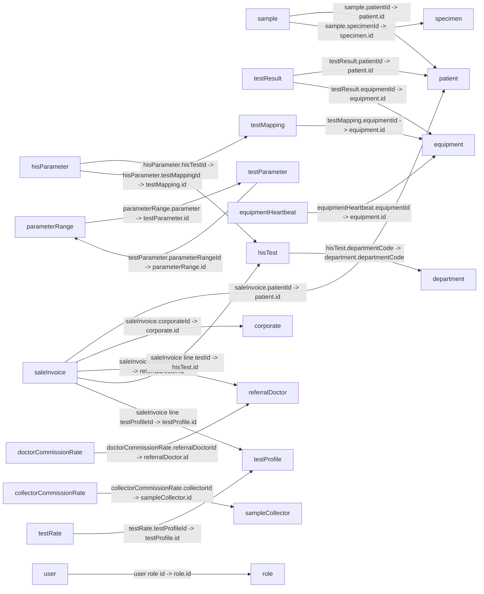

# ZoryaLMS Left-Menu Entity Relationship Diagram

This ERD is limited to the data modules exposed through the current left menu. It excludes unrelated legacy modules and hidden LIS definitions.

## Scope

| Left-menu section | Included persisted modules |
|---|---|
| Working Board | `sample`, `testResult`, `radiologyResult`, `controlResult` |
| Setup | `department`, `unit`, `method`, `equipment`, `equipmentHeartbeat`, `reportTemplateConfiguration` |
| Master | `hisTest`, `testProfile`, `specimen`, `testRate`, `referralDoctor`, `doctorCommissionRate`, `sampleCollector`, `collectorCommissionRate`, `corporate`, `hisParameter`, `testMapping`, `testParameter`, `parameterRange` |
| Transaction | `patient`, `saleInvoice` |
| Account | `user`, `role` |

The Working Board workflows also read/write these menu modules; they are not separate collections. Reports are views over existing collections, and Commission Payout currently has no persisted payout schema, so neither adds an entity here. Notification Configuration and Report Layout Configuration are menu entries, but their React pages are local previews with saving disabled; they are not included as persisted entities. Change Password uses Firebase Authentication, not a Firestore entity.

## Relationship diagram

Arrows point from the document containing a lookup field to its target. Labels use `source.field -> target.field`. They are not database-enforced foreign keys or cardinality guarantees. Only relationships between included menu modules are drawn.

## Field mapping rules

- The LIS `relation()` helper stores the configured `valueField`; it defaults to the Firestore document ID (`id`). The menu module `hisTest.departmentCode` stores `department.departmentCode`.
- The custom Sale Invoice page selects Patient, Corporate, Referral Doctor, HIS Test, and Test Profile documents by ID. It embeds selected test/profile data in invoice line maps; department values and copied labels are snapshots, not guaranteed references.
- User Roles are embedded maps in `user.roles[]` containing the selected `role.id`, role name, and a copy of role privileges.
- Values described as lookups are strings in Firestore, not Firestore `DocumentReference` values. Firestore does not enforce referential integrity.
- `*` means the form marks the field as required; it does not mean Firestore validates it.
- Common fields added by the shared Firestore service are `status: string`, `schema: string`, `user: string`, `dateCreated: string`, `application: string`, and `access: string`. Firestore document IDs are exposed by the application as `id: string`.
- Date and datetime fields follow form controls; the application does not consistently enforce Firestore Timestamp types.

## Menu module fields

Types are based on current React form definitions. `enum<string>` lists the menu choices; `array<map>` denotes embedded data.

### Working Board

| Collection | Fields |
|---|---|
| `sample` | `sampleNo: string*`; `testRequestId: string` (lookup to out-of-scope `testRequest.id`); `patientId: string*` (lookup to `patient.id`); `specimenId: string` (lookup to `specimen.id`); `barcode: string`; `sampleCollectionDate: datetime`; `collectedBy: string`; `collectionStatus: enum<string> [Pending, Collected, Rejected]`; `sampleReceivedDate: datetime`; `receivedBy: string`; `receivingStatus: enum<string> [Pending, Received, Rejected]`; `rejectionReasonId: string` (lookup to out-of-scope `lookupMaster.id`); `status: enum<string> [Pending, Collected, Received, Rejected, Processing, Completed]` |
| `testResult` | `patientId: string*` (lookup to `patient.id`); `testRequestId: string*` (lookup to out-of-scope `testRequest.id`); `sampleNo: string`; `hisTestCode: string`; `lisTestCode: string`; `specimenCode: string`; `specimenName: string`; `resultDate: datetime`; `sampleCollectionDate: datetime`; `sampleReceivedDate: datetime`; `authorizationDate: datetime`; `authorizedBy: string`; `reviewDate: datetime`; `reviewedBy: string`; `technicianNote: string`; `doctorNote: string`; `equipmentId: string` (lookup to `equipment.id`) |
| `radiologyResult` | `radiologyRequestId: string*` (lookup to out-of-scope `radiologyRequest.id`); `findings: string`; `impression: string`; `reportDateTime: datetime`; `reportedBy: string`; `status: enum<string> [Draft, Finalized, Cancelled]` |
| `controlResult` | `controlNo: string*`; `testName: string*`; `controlLevel: enum<string> [Level 1, Level 2, Level 3]`; `resultDate: date`; `status: enum<string> [In Control, Out of Control]` |

### Setup

| Collection | Fields |
|---|---|
| `department` | `departmentCode: string*`; `departmentName: string*`; `isActive: enum<string> [Yes, No]` |
| `unit` | `code: string*`; `name: string*`; `isActive: enum<string> [Yes, No]` |
| `method` | `code: string*`; `name: string*`; `isActive: enum<string> [Yes, No]` |
| `equipment` | `name: string*`; `model: string`; `accessKey: string*`; `isActive: enum<string> [Yes, No]` |
| `equipmentHeartbeat` | `equipmentId: string*` (lookup to `equipment.id`); `lastHeartBeatTime: datetime*`; `isOnline: enum<string> [Yes, No]`; `lastErrorMessage: string`; `recordedOn: date` |
| `reportTemplateConfiguration` | `templateName: string*`; `templateType: string`; `templateContent: string`; `isActive: enum<string> [Yes, No]` |

### Master

| Collection | Fields |
|---|---|
| `hisTest` | `hisTestCode: string*`; `hisTestCodeDescription: string*`; `hisSpecimenCode: string`; `hisSpecimenName: string`; `departmentCode: string` (lookup value is `department.departmentCode`); `isActive: enum<string> [Yes, No]` |
| `testProfile` | `code: string*`; `name: string*`; `packageRate: number`; `isActive: enum<string> [Yes, No]` |
| `specimen` | `specimenCode: string*`; `specimenName: string*`; `isActive: enum<string> [Yes, No]` |
| `testRate` | `rateName: string*`; `lisTestId: string` (lookup to out-of-scope `lisTest.id`); `testProfileId: string` (lookup to `testProfile.id`); `rate: number*`; `effectiveFrom: date`; `effectiveTo: date`; `hospitalId: string` (lookup to out-of-scope `hospital.id`); `isActive: enum<string> [Yes, No]` |
| `referralDoctor` | `doctorCode: string*`; `doctorName: string*`; `qualification: string`; `phoneNumber: string`; `email: string`; `isActive: enum<string> [Yes, No]` |
| `doctorCommissionRate` | `referralDoctorId: string*` (lookup to `referralDoctor.id`); `commissionPercent: number*`; `effectiveFrom: date*`; `effectiveTo: date`; `isActive: enum<string> [Yes, No]` |
| `sampleCollector` | `code: string*`; `name: string*`; `phone: string`; `isActive: enum<string> [Yes, No]` |
| `collectorCommissionRate` | `collectorId: string*` (lookup to `sampleCollector.id`); `commissionPercent: number*`; `effectiveFrom: date*`; `effectiveTo: date`; `isActive: enum<string> [Yes, No]` |
| `corporate` | `code: string*`; `name: string*`; `defaultDiscountPercent: number`; `isActive: enum<string> [Yes, No]` |
| `hisParameter` | `hisParamCode: string*`; `hisParamDescription: string*`; `hisTestId: string*` (lookup to `hisTest.id`); `testMappingId: string` (lookup to `testMapping.id`); `lisParamCode: string`; `unit: string`; `lowerRefRange: number`; `upperRefRange: number`; `isActive: enum<string> [Yes, No]` |
| `testMapping` | `equipmentId: string*` (lookup to `equipment.id`); `hisParamCode: string`; `hisParamDescription: string`; `specimenCode: string`; `specimenName: string`; `lisTestCode: string*`; `lisTestCodeDescription: string*`; `groupName: string`; `isActive: enum<string> [Yes, No]` |
| `testParameter` | `parameterCode: string*`; `parameterName: string*`; `lisTestId: string*` (lookup to out-of-scope `lisTest.id`); `unit: string`; `parameterRangeId: string` (lookup to `parameterRange.id`); `isActive: enum<string> [Yes, No]` |
| `parameterRange` | `rangeCode: string` (read-only); `rangeValue: string`; `gender: enum<string> [Male, Female, Both]*`; `ageFrom: number`; `ageTo: number`; `ageType: enum<string> [Year, Month, Day]`; `minValue: number`; `maxValue: number`; `parameter: string*` (lookup to `testParameter.id`) |

### Transaction

| Collection | Fields |
|---|---|
| `patient` | `mrNo: string` (read-only); `visitId: string` (read-only); `name: string*`; `hisPatientId: string`; `phoneNumber: string*`; `dateOfBirth: date`; `patientNo: string` (read-only); `salutation: enum<string> [Mr, Mr., Miss, Mrs., Ms.]*`; `gender: enum<string> [M, F]*`; `age: number`; `address: string`; `active: enum<string> [Yes, No]` (edit/view schema) |
| `saleInvoice` | Generic module fields: `invoiceNo: string*`; `invoiceDate: date*`; `invoiceStatus: enum<string> [Draft, Finalized, Cancelled]`; `paymentStatus: enum<string> [Pending, Paid]`; `patientId: string*` (lookup to `patient.id`); `requestDetailId: string` (lookup to out-of-scope `testRequest.id`); `patientVisitId: string` (lookup to out-of-scope `patientVisit.id`); `totalAmount: number`. Custom Add page additionally writes `name: string`; `patientName: string`; `patientNo: string`; `patientPhone: string`; `corporateId: string|null` (document ID); `referralDoctorId: string|null` (document ID); `paymentType: enum<string> [Cash, Card, UPI, Net Banking, Cheque, Credit]`; `notes: string`; `invoiceStatus: number [0 Draft, 1 Confirmed]`; `paymentStatus: number [0 Unpaid, 1 Partially Paid, 2 Paid]`; `grossAmount: number`; `discountType: enum<string> [Fixed Amount, Percentage]`; `discountValue: number`; `discountAmount: number`; `taxAmount: number`; `netAmount: number`; `paidAmount: number`; `dueAmount: number`; `lines: array<map>`. The custom Add page does not write `totalAmount`, `requestDetailId`, or `patientVisitId`. |
| `saleInvoice.lines[]` (embedded map) | `itemType: enum<string> [test, profile]`; `lineItemKey: string`; `testId: string` (HIS Test document ID for test lines, empty for profile lines); `testProfileId: string|null` (Test Profile document ID for profile lines); `testName: string`; `departmentCode: string`; `departmentName: string`; `rate: number`; `quantity: number`; `discountType: enum<string> [Fixed Amount, Percentage]`; `discountValue: number`; `amount: number`; `discountAmount: number`; `netAmount: number`. No line-level `taxAmount` or `sampleNo` is written. |

### Account

| Collection | Fields |
|---|---|
| `user` | `email: string*`; `firstName: string*`; `lastName: string*`; `phoneNumber: string`; `department: enum<string> [Civil, Legal]*`; `disable: boolean`; `address: string`; `photoUrl: string`; `roles: array<map>` containing `id: string` (role document ID), `name: string`, and copied `privileges: array<map>`; `privileges: array<map>` (derived/read-only in user form); Auth-created records may also include `uid: string` and `displayName: string` |
| `role` | `name: string*`; `privileges: array<map>` |

## References outside this ERD scope

The selected menu modules have fields that refer to non-menu collections. Their fields are intentionally not included here: `testRequest` (sample, result, and generic invoice lookups), `testResultDetail` and `controlResultDetail` (workflow detail rows), `lookupMaster` (sample rejection reason), `radiologyRequest` (radiology result), `lisTest` and `hospital` (test rate and test parameter), and `patientVisit` (generic invoice). The `saleInvoiceDetail` collection is also not used by the custom Sale Invoice Add page, which embeds its line items.

## Maintenance

Keep this ERD scoped to `lisModuleMenu` in `src/pages/app/schema/lisModuleDefinitions.js`, the custom menu routes in `src/pages/app/LISWorkflowPages.jsx` and `src/pages/app/LISSetupPages.jsx`, and the Patient/User/Role forms. When a menu item or field mapping changes, update the relevant table and relationship diagram from those definitions.
